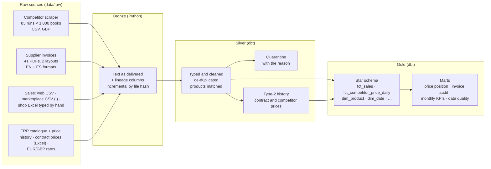

# Retail Price & Procurement Intelligence

An end-to-end data platform for a (fictional) online bookseller: four messy real-world
sources go into a **bronze → silver → gold lakehouse** in DuckDB + dbt, with **143 automated
data tests**. The output answers three business questions:

1. **Are we more expensive than the competitor, and what does it cost us?**
2. **Are suppliers billing what the contract says?**
3. **Can we trust the numbers?** Every defect is counted, explained and traced to its source file.

Runs from scratch in about 20 seconds on a laptop, for free. No cloud account needed.

📖 **[Data dictionary](docs/data_dictionary.md)**: every table and column, with type, primary and foreign keys, grain, lineage and checks.

> All companies, people and figures are fictional. The competitor catalogue is
> [books.toscrape.com](https://books.toscrape.com), a public sandbox built for scraping practice.

---

## Architecture



| Layer | Tool | Rule |
|---|---|---|
| **Bronze** | Python + DuckDB | No business logic. Every value is stored as text, exactly as delivered, with `_source_file`, `_file_hash`, `_batch_id`, `_ingested_at` and `_row_number`. A file is loaded once per content hash. A changed file replaces its own rows. A file that cannot be read is logged as `FAILED` and the run carries on. New columns are added automatically (schema drift). |
| **Silver** | dbt | Types, parsing (`1.234,56 €` and `1,234.56 EUR`, `dd/mm/yyyy` and ISO), de-duplication, product matching, one data-quality verdict per row. Bad rows go to quarantine with their reason; nothing is dropped silently. |
| **Gold** | dbt | Star schema and business marts, ready for a dashboard or Power BI. |

## What the data shows (Jan–Oct 2026)

| | |
|---|---|
| Net revenue | **€1.05 M** across 3 channels, 24,691 books sold |
| Gross margin | **35.1 %** after marketplace commission and supplier cost |
| Price position | Inkwell was **+3.2 % above the competitor in January**. After the April and August repricing it was **2.9 % below**. |
| Price elasticity | Products priced *much higher* (>10 %) than the competitor sell **22 % fewer units a week** than products priced *lower* (2.82 vs 3.64). |
| Supplier invoices | **€9,695 at risk** in 12 of 41 invoices: one invoice sent twice (€8,543), a price increase billed two weeks early, 10 lines above contract, and 2 totals that don't add up |

## Data quality: every defect found and counted

The sources are messy on purpose, the way real exports are. The generator writes down every
defect it injects (`data/raw/_injected_defects.json`), and a dbt test fails the build
unless the pipeline finds **exactly** those defects.

| Source | Problem | Rows | What the pipeline does |
|---|---|---|---|
| Marketplace CSV | Monthly exports overlap by 3 days | 590 | De-duplicated (copy from the latest export kept) |
| Marketplace CSV | Seller SKU missing | 697 | Matched by title |
| Shop Excel | No SKU, titles typed by hand (case, missing or swapped letters) | 3,289 | Exact title key, then fuzzy match (Damerau-Levenshtein ≤ 2 or Jaro-Winkler ≥ 0.95); score kept for audit |
| Shop Excel | Price typed ×10 (14.99 → 149.9) | 16 | Quarantined (`price_outlier`): compared with the price valid **on the sale date**, not today's |
| ERP | 20 titles migrated without price history | 1,893 lines | Price check falls back to that week's median price (≥ 3 sales), then to today's list price |
| Shop Excel | Gift cards sold through the till (not books) | 25 | Quarantined (`unknown_product`) |
| Shop Excel | Missing quantity · dates as text | 8 · 162 | Quarantined · parsed |
| Competitor scraper | Price 0.00 or ×100 (parser glitch) | 34 | Observation ignored |
| Competitor scraper | 2 runs missing, 1 run stopped half way | 3 runs | Last valid price carried forward (ASOF join) |
| ERP | Product without a link to the competitor page | 45 | Linked by unique title |
| FX rates | Weekends and holidays have no rate | 88 days | Last business-day rate, flagged |
| Supplier PDFs | Duplicate · wrong total · price above contract | 1 · 2 · 25 lines | Listed in the invoice audit with the amount at risk |

Every bronze sales row ends up in `silver_sales` or in `silver_sales_quarantine`. A
reconciliation test checks that no row is lost.

**Why the price check uses the price on the sale date.** One title goes on clearance on 1 September
(€73.99 → €20.49). Its 48 earlier sales at full price are correct, but they are more than 3× today's
price. Comparing with the current ERP price would quarantine all 48 by mistake (64 flagged instead of 16).
The pipeline compares each sale with (A) the ERP list-price history, (B) if a title has no history,
the median price of that title that week across channels, or (C) as a last resort today's list price.
The source used is stored on every row (`reference_price_source`), and a test fails if any clearance
sale is flagged.

## Techniques shown

- **Medallion architecture** with lineage columns and an ingestion log
- **Incremental, idempotent ingestion** by content hash, with schema-drift handling
- **PDF extraction** of two supplier layouts (pdfplumber + one regex per layout), with raw values kept for replay
- **Type-2 history (SCD2)**: contract prices and list prices with validity periods, and competitor prices built with gaps-and-islands
- **Point-in-time validation**: each sale checked against the price valid that day, with a two-level fallback
- **ASOF join** for the latest competitor price at the end of each day, with a "days since observed" column
- **Fuzzy matching** of hand-typed titles, with the score and edit distance kept for audit
- **Data-quality framework**: a verdict per row, quarantine tables, a `mart_data_quality` summary and 143 dbt tests (generic, custom generic and singular, including a primary-key test on every table)
- **Polite live scraper** (`python run.py scrape`): robots.txt, delays, retries with back-off. It writes the same file shape as the simulated runs.
- **Documentation as code**: table and column descriptions live in the dbt YAML (shared texts as dbt doc blocks); the data dictionary is generated from them plus the warehouse, so it cannot drift from the code
- **CI**: GitHub Actions builds the whole platform from scratch and checks that a second ingest loads nothing

## Run it

```bash
python -m venv .venv
.venv\Scripts\activate            # Windows  (macOS/Linux: source .venv/bin/activate)
pip install -r requirements.txt
python run.py all                 # generate sources → bronze → dbt build (models + tests)
```

| Command | Does |
|---|---|
| `python run.py generate` | (Re)creates the fictional source files in `data/raw/` (same seed, same files) |
| `python run.py ingest` | Loads new or changed files into bronze. Run it twice: the second run loads nothing. |
| `python run.py transform` | `dbt build`: silver and gold models and all data tests |
| `python run.py scrape` | Optional: a real snapshot of books.toscrape.com into `data/raw/competitor/` |
| `python run.py report` | Prints the main results: `kpis`, `invoices`, `prices`, `quality` (or `--sql "select …"` for your own query) |
| `python run.py ui` | Opens every table in DuckDB's web UI at http://localhost:4213 (press Enter in the terminal to close it) |
| `python run.py docs` | Regenerates [docs/data_dictionary.md](docs/data_dictionary.md) from the dbt YAML descriptions and the warehouse (types, keys, row counts, tests) |

The warehouse is a single file, `data/warehouse/retail.duckdb`. You can open it with the DuckDB
CLI, DBeaver, Python or Power BI (ODBC).

## Project layout

```
generators/          fictional sources: world.py (ground truth), sources.py, invoices.py (PDFs)
pipeline/            bronze.py (ingestion), pdf_invoices.py, scraper.py, config.py
dbt/models/silver/   staging, matching, quarantine, SCD2 histories
dbt/models/gold/     dim_*, fct_*, mart_*
dbt/tests/           reconciliation, SCD2 continuity, invoice arithmetic, injected-defects check
run.py               one entry point for every step
```

## Roadmap

- [ ] Interactive dashboard published as a static site
- [ ] Orchestration with Dagster (asset graph, schedules)
- [ ] Databricks Free Edition variant (PySpark + Delta) of the silver/gold layers
