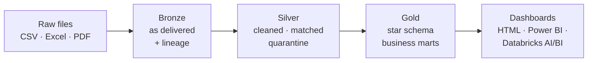
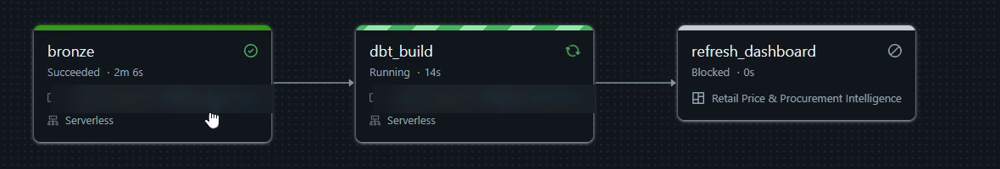
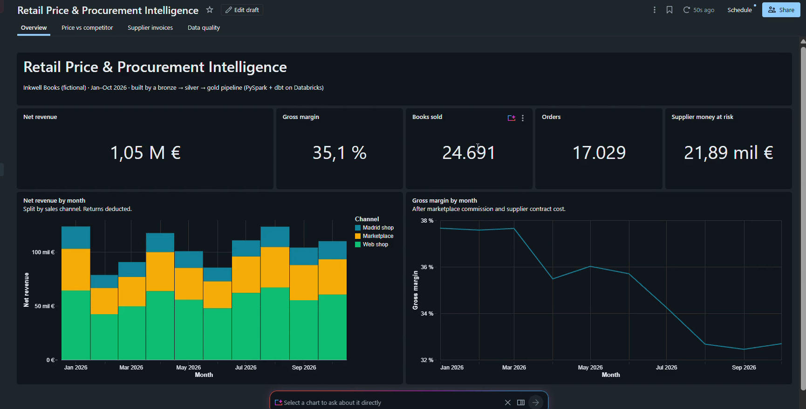
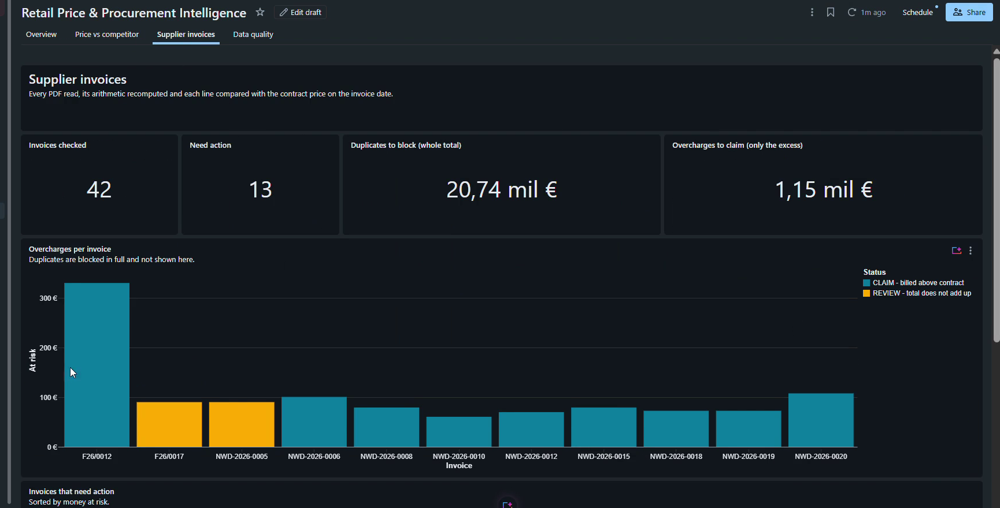

# Case study: a data pipeline that survives messy data

**Retail Price & Procurement Intelligence** · an end-to-end data platform for a fictional online
bookseller, built on a laptop (Python, DuckDB, dbt) and on Databricks (PySpark, Delta Lake, Unity
Catalog), with identical results on both.

| At a glance | |
|---|---|
| **Business questions** | Are we dearer than the competitor, and what does it cost us? Are suppliers billing what the contract says? Can we trust the numbers? |
| **Sources** | 4 messy sources: competitor prices scraped twice a week, 41 supplier invoice PDFs in 2 layouts, sales from 3 channels (web CSV, marketplace CSV, a shop Excel typed by hand), ERP catalogue, contract prices and FX rates |
| **Built with** | Python · DuckDB · dbt · SQL · PySpark · Delta Lake · Unity Catalog · Databricks Jobs · AI/BI and Power BI dashboards · GitHub Actions |
| **Quality** | 143 dbt data tests and 9 robustness tests on every build |
| **Result** | €1.05M of sales reconciled to the cent, €9,695 at risk found in 12 supplier invoices, and the same numbers on DuckDB and Databricks |

## 1. The challenge

Real business data does not arrive clean. In this project, on purpose, it does not either:

- the marketplace exports overlap, so the same sale appears twice;
- the shop types book titles by hand, with typos and no product code;
- a cashier types a price ten times too high;
- the competitor scraper sometimes reads a price of 0.00, or stops half way;
- a supplier sends the same invoice twice, and bills a price increase two weeks early.

The goal: answer the business questions **and** be able to prove every number, down to the source
file and row it came from.

## 2. The solution: a medallion pipeline

| Layer | What it does |
|---|---|
| **Bronze** | Loads every file exactly as delivered, with its source file, row number and load batch. Incremental: a file is read once; a changed file replaces its rows; a removed file takes its rows out. |
| **Silver** | Types, cleans and matches products (fuzzy matching for hand-typed titles). Each row gets a quality verdict **before** de-duplication. Bad rows go to a quarantine table with the reason: nothing is dropped silently. |
| **Gold** | A star schema and the business marts: monthly KPIs, price position against the competitor, the supplier invoice audit and a data-quality summary. |

The same dbt project runs on DuckDB (local, about 20 seconds, free) and on Databricks, where it runs
as one serverless job: bronze in PySpark to Delta tables, then dbt, then the dashboard refresh.

## 3. Messy data, handled

| Problem in the source | Rows | What the pipeline does |
|---|---:|---|
| Marketplace exports overlap by 3 days | 590 | De-duplicated, the valid copy kept |
| Shop titles typed by hand, no product code | 3,289 | Matched by exact title key, then fuzzy match, with the score kept for audit |
| Price typed ×10 in the shop | 16 | Quarantined, compared with the price valid **on the sale date** |
| Gift cards sold through the till | 25 | Quarantined as unknown product |
| Competitor price 0.00, ×100 or ÷100 | 34 | Observation ignored |
| Scraper runs missing or stopped half way | 3 runs | Last valid price carried forward, for 7 days at most |
| Weekends without an FX rate | 86 days | Last business-day rate, flagged |
| Duplicate invoice, wrong totals, prices above contract | 1 · 2 · 25 lines | Listed in the invoice audit, with the amount at risk |

The data generator writes down every defect it injects, and a test fails the build unless the
pipeline finds **exactly** those defects. Another test checks that every raw sales row ends up
either in the clean table or in quarantine: no row is ever lost.

## 4. Stress test: a new month arrives

A pipeline is not judged on the day of the demo but on the first day of every month. So the
landing zone was rewound to 30 September, and then October arrived with three surprises:

| Surprise | What the pipeline did |
|---|---|
| The October web sales file sent again, as `web_orders_2026-10 (1).csv` | One copy loaded, the other logged as a duplicate file: sales are not doubled |
| An invoice PDF cut off half way through the upload | Logged as failed with the reason ("Unexpected EOF"); every other file still loaded |
| Invoice NWD-2026-0020 sent a second time | Loaded, marked as a duplicate, and **blocked** in the invoice audit: €12,194 not paid twice |

| | 30 September | After October arrived |
|---|---:|---:|
| Months in the dashboard | 9 | 10 |
| Net revenue | €936,400 | €1,046,595 |
| Money at risk in supplier invoices | €9,515 | €21,889 (€12,194 of it, the duplicate) |

Only the 19 new files were read (17 loaded, 1 duplicate, 1 failed); the 144 files already loaded
were skipped. On Databricks, the
job ran on its own and the dashboard refreshed itself:

## 5. Results

| | |
|---|---|
| **Net revenue** | €1.05M across 3 channels, 24,691 books sold, 35.1% gross margin |
| **Price position** | +3.2% dearer than the competitor in January; 2.9% cheaper after two repricing rounds |
| **Price sensitivity** | Books priced much higher than the competitor sell 23% fewer units a week |
| **Supplier invoices** | €9,695 at risk in 12 of 41 invoices: a duplicate, a price increase billed early, 10 lines above contract and 2 totals that do not add up |
| **Two engines** | DuckDB and Databricks give the same rows per file, the same 28 tables and the same 10 business figures, to the cent |

## 6. How I work

- **Tests on every load.** 143 dbt data tests (keys, relationships, accepted values, reconciliation,
  business rules) and 9 robustness tests that damage the input on purpose and check the result.
- **Proof, not promises.** An automated comparison checks the two engines file by file, table by
  table and figure by figure.
- **Problems found early.** The October test found a real bug: on Databricks, two identical files
  arriving in the same batch were both loaded, because Spark writes a whole source at the end of the
  batch. The clean layer still kept the figures right (the repeated orders went to quarantine), the
  automated comparison flagged the difference, and it was fixed and verified the same day.
- **No secrets in the job.** The Databricks job authenticates as itself; credentials stay out of
  the code and the repository.
- **Documentation as code.** Table and column descriptions live next to the models, and the data
  dictionary is generated from them, so it cannot drift from the code.

---

All companies, people and figures are fictional.

Code and documentation: [github.com/Mrguez5/retail-intelligence](https://github.com/Mrguez5/retail-intelligence)
